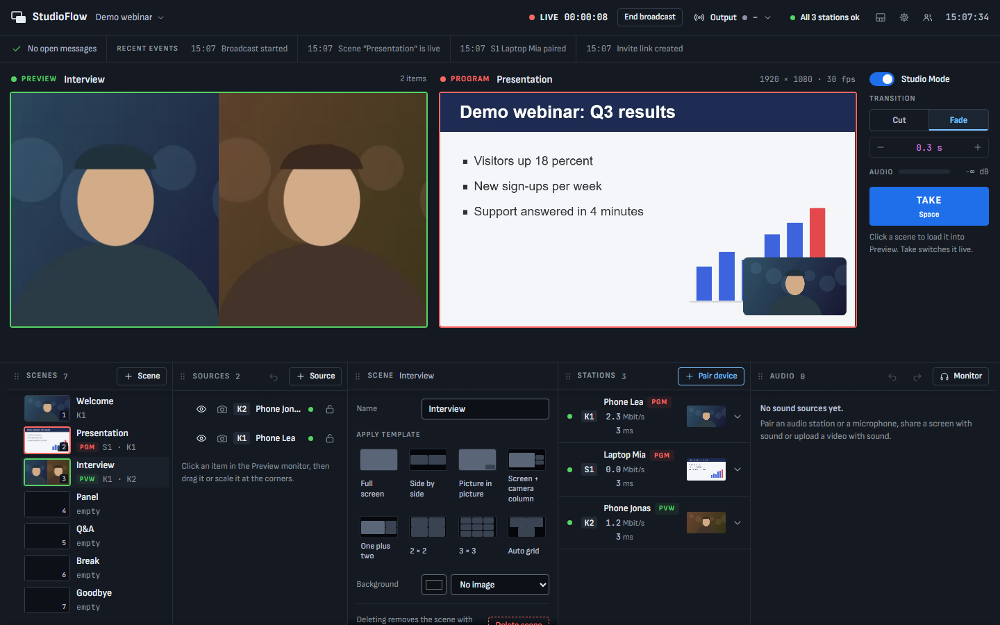
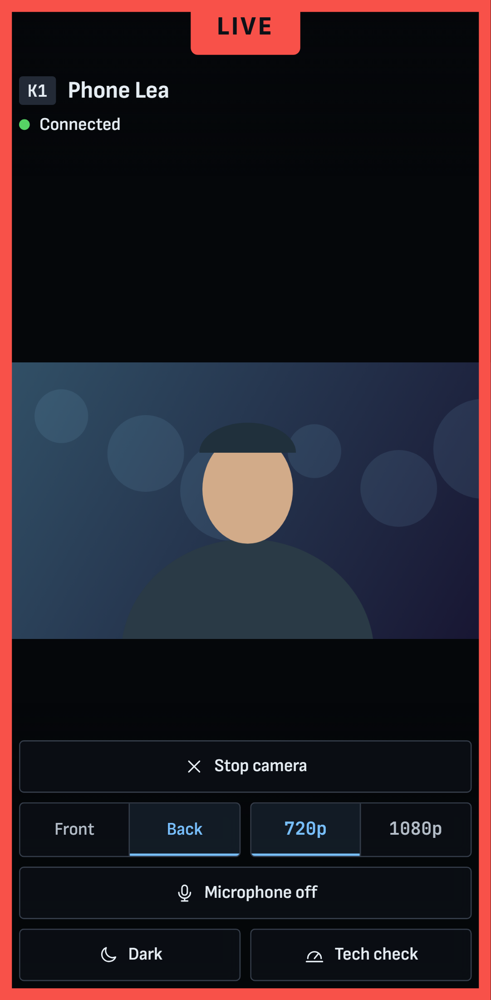
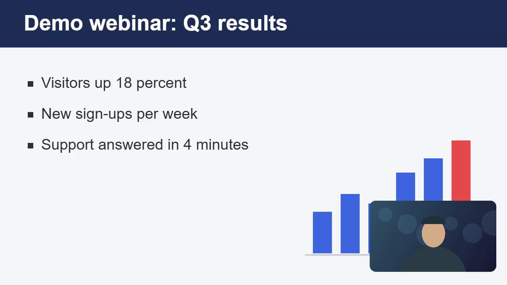
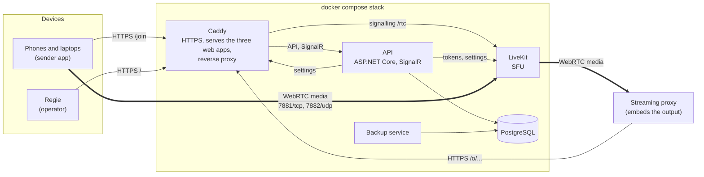

<p align="center">
  <picture>
    <source media="(prefers-color-scheme: dark)" srcset="docs/assets/logo-dark.svg">
    
  </picture>
</p>

<h3 align="center">A browser-based live production studio for webinars: phones and laptops as sources, OBS-like switching, a 16:9 output page.</h3>

<p align="center"><a href="https://opten.github.io/StudioFlow/"><b>opten.github.io/StudioFlow</b></a>: the product site, with a demo and the quick start</p>

<p align="center">
  <a href="LICENSE"></a>
  <a href="https://github.com/OPTEN/StudioFlow/actions/workflows/ci.yml"></a>
  <a href="https://github.com/OPTEN/StudioFlow/releases/latest"></a>
</p>

StudioFlow is a web-based Regie (control room) modelled on OBS and made for webinars.

- Phones and laptops send camera and screen directly from the browser. There is no app to install.
- The Regie composes scenes from them and switches the program.
- The output is a 16:9 web page. A streaming proxy embeds it as an iframe and distributes the picture to the audience.
- Everything runs in one Docker Compose stack on your own server. There are no cloud services.



<p align="center">
  
  &nbsp;&nbsp;
  
</p>

_All screenshots show synthetic demo content (drawn stand-ins for cameras and a slide). The Regie also has a
[light mode](docs/assets/screenshot-regie-light.png)._

## Features

- **Scenes** with layout templates (full screen, side by side, picture in picture, grids ...) and free editing: move,
  scale and crop every item.
- **Studio Mode** as in OBS: check a scene in the preview, then **Take** it to the program, as **Cut** or **Fade**.
- **Free docks:** scenes, sources, scene editor, stations and audio can be moved, resized and hidden. The browser
  remembers the layout.
- **Pairing without accounts:** phones by QR code, laptops by a short URL with a check code and approval in the Regie,
  or by a one-time invite link.
- **Tally** on every device: you see on the phone whether its camera is in the program or the preview.
- **16:9 output page** for an iframe or a streaming proxy, behind a secret link that can be revoked.
- **Hold frames and endless reconnect:** when a source drops, the last frame stays and the device reconnects by itself.
- **Audio mixer:** an audio station at the mixing desk, screen sound and video sound.
- **Text and lower thirds** as sources.
- **Camera control** from the Regie: zoom, lens switch, focus, brightness and light of a phone, as far as its browser allows.
- **Productions** can be duplicated, exported and imported on another server.
- **Light and dark mode**, English and German (Switzerland) interface.
- **Audit log** of everything that happens, and scheduled **backups** with restore.
- **One `docker compose` stack**, no cloud services, no scripts.

## Try the prototype

The clickable Regie prototype is one HTML file with the fonts inlined. It works offline and needs no installation:

**[Open it on the product site](https://opten.github.io/StudioFlow/studioflow-prototype.html)**, or
**[download studioflow-prototype.html](https://github.com/OPTEN/StudioFlow/releases/latest/download/studioflow-prototype.html)**
and open it in a browser.

It is the design prototype the product started from, not the running system, and all data in it is synthetic. You can
also open `prototype/regie.html` from a clone, or build the file yourself with `npm run build:prototype`.

## Quick start

You need Docker (Engine on Linux, Docker Desktop on Windows or macOS) with Compose v2.24 or newer. There is no script to
run and no file to write. Download `docker-compose.yml` from the
[latest release](https://github.com/OPTEN/StudioFlow/releases/latest) (it pulls the ready-made images
`ghcr.io/opten/studioflow-*`) or use the one in a clone (it builds the images), then:

```bash
docker compose up -d      # from the folder that holds docker-compose.yml
docker compose logs api   # the line "Setup code: XXXX-XXXX"
```

1. Open `https://<address of this computer>:8443/` and accept the certificate warning once.
2. Enter the setup code and follow the first-run wizard: account, media address (with a connection test), address and
   certificate, embedding.
3. **Pair a phone:** open the pairing dock in the Regie and scan the QR code with the phone. The camera appears in the
   Stations dock.

Open ports: **8443/tcp and 8443/udp** (HTTPS and HTTP/3), and the media ports **7881/tcp** and **7882/udp**. Nothing
listens on port 80. Updating is `docker compose pull && docker compose up -d`; a backup by hand is
`docker compose run --rm backup backup-now`.

Certificates (local, Let's Encrypt through DNS, your own), the firewall, backups, updates and troubleshooting are in the
[operations guide](docs/runbook.md).

## Architecture



Caddy serves the three web apps: the **Regie** (`/`), the **sender** (`/join`) for phones and laptops, and the **output**
page (`/o/...`). Control goes over HTTPS and SignalR to the API: scenes, the program and preview, pairing, tally and
reports of the devices. Picture and sound do not pass through the API: the senders publish over WebRTC to LiveKit
(the SFU), and the output page and the Regie previews subscribe to it. The API hands out the short-lived tokens, writes
the server settings that Caddy, LiveKit and the backup service apply, and keeps all state in PostgreSQL. The `init`
service makes the internal secrets once. Details: [implementation spec](docs/architecture/implementation-spec.md) and
[operations guide](docs/runbook.md), section 1.

## Development

Prerequisites: **Node.js 22.22.3 or newer** (`.nvmrc`), the **.NET 10 SDK** and **Docker** with Compose v2.

```bash
npm ci                    # once, and after every change of package-lock.json
cp docker-compose.override.example.yml docker-compose.override.yml
docker compose up -d --build   # API, LiveKit and PostgreSQL in containers, reachable on this machine only
npm run start:studio      # the Regie on http://localhost:4200
npm run start:sender      # the sender on http://localhost:4201
npm run start:output      # the output page on http://localhost:4202
```

The first start prints the setup code in the API log (`docker compose logs api`). To run the API outside Docker, use
`dotnet run --project apps/api/src/Opten.StudioFlow.Web` (it listens on http://localhost:5298 and needs PostgreSQL and
LiveKit). The header of [docker-compose.override.example.yml](docker-compose.override.example.yml) has the exact steps.

After a change of a route or a DTO of the API, regenerate the contracts and commit them: `npm run gen:contracts`.

| Command | What it runs |
|---|---|
| `npm run check` | i18n checks, German-text check, TypeScript type check |
| `npm run format:check` | Prettier |
| `npm run test:unit` | Vitest: shared packages, output page, tools |
| `npm run test:studio`, `npm run test:sender` | Angular unit tests of the Regie and the sender |
| `npm run test:api` | .NET tests (the integration tests start PostgreSQL with Docker) |
| `npm run build:web` | production build of the three web apps |
| `tests/e2e/stack.sh up 1`, then `E2E_REUSE_STACK=1 tests/e2e/stack.sh test 1 --project=smoke`, then `tests/e2e/stack.sh down 1` | end-to-end tests in a browser against a real stack |
| `npm run test:e2e` | the whole end-to-end suite (long) |

The end-to-end harness is described in [tests/e2e/README.md](tests/e2e/README.md), the test plan in
[docs/testing.md](docs/testing.md).

Project structure:

| Path | Content |
|---|---|
| `apps/studio`, `apps/sender` | Angular: the Regie and the sender PWA |
| `apps/output` | the framework-free output page (Vite) |
| `apps/api` | ASP.NET Core API (`src`) and its tests (`tests`); EF Core, PostgreSQL, SignalR |
| `packages/*` | shared TypeScript: `scene-model`, `scene-renderer`, `media-client`, `realtime-client`, `i18n` |
| `infra` | Caddy, LiveKit, backup and release helpers |
| `tests/e2e` | the Playwright end-to-end suite |
| `docs` | specification, decisions, operations guide, test plan, release process |
| `prototype` | the clickable Regie prototype |
| `site` | the product site on GitHub Pages (`npm run start:site`, `npm run build:site`, deployed by `pages.yml`) |
| `video` | the product video: composition, render and audio scripts (`video/README.md`) |

## Configuration

StudioFlow needs no `.env`. Address, media address, certificate and embedding are set in the first-run wizard and later
under Server settings in the Regie. A `.env` next to `docker-compose.yml` is only for overrides; the complete list with
explanations is [.env.example](.env.example), the operations in [docs/runbook.md](docs/runbook.md).

| Variable | Default | Purpose |
|---|---|---|
| `STUDIOFLOW_HTTPS_PORT` | `8443` | HTTPS port of the Regie, output and phones (use `443` if it is free) |
| `STUDIOFLOW_RTC_TCP_PORT`, `STUDIOFLOW_RTC_UDP_PORT` | `7881`, `7882` | LiveKit media ports |
| `STUDIOFLOW_IMAGE_TAG` | `latest` | version of the images (release file only) |
| `STUDIOFLOW_IMAGE_REGISTRY` | `ghcr.io/opten` | registry path of the images, for example a mirror |
| `STUDIOFLOW_SUBNET` | | subnet of the Compose network, if it collides with the LAN or a VPN |
| `STUDIOFLOW_TRUSTED_PROXIES` | `127.0.0.1/32` | proxies in front of Caddy whose `X-Forwarded-For` is trusted |
| `STUDIOFLOW_MAX_UPLOAD`, `STUDIOFLOW_MAX_IMPORT`, `STUDIOFLOW_MAX_BODY` | `1100MiB`, `4100MiB`, `10MB` | request size limits in Caddy |
| `AUDIT_RETENTION_DAYS`, `AUDIT_IP_RETENTION_DAYS` | `365`, `90` | how long the audit log keeps entries and IP addresses |
| `BACKUP_WARN_AFTER_HOURS` | `48` | the health check warns when the last backup is older |

## Roadmap

Done: scenes and templates, Studio Mode with cut and fade, docks, pairing, tally, output page, hold frames and
reconnect, audio mixer, text and lower thirds, camera control, duplicate/export/import, light and dark mode, audit log,
backups, releases as ready-made images.

Planned (see [PRODUCT.md](PRODUCT.md) and [docs/decisions.md](docs/decisions.md)):

- restream and recording of the program
- audio levels per scene and a preview mix
- a public air mode for viewers without a proxy
- multi-tenancy (provided for in the data model)
- overlays and web pages as sources

## Contributing, security, licence

- [CONTRIBUTING.md](CONTRIBUTING.md) explains how to get started, test and open a pull request, and
  [CODE_OF_CONDUCT.md](CODE_OF_CONDUCT.md) applies to everyone taking part.
- Report vulnerabilities privately, not in a public issue: [SECURITY.md](SECURITY.md).
- StudioFlow is licensed under the [MIT License](LICENSE); see [NOTICE](NOTICE) and
  [THIRD_PARTY_NOTICES.md](THIRD_PARTY_NOTICES.md) for the third-party components.
